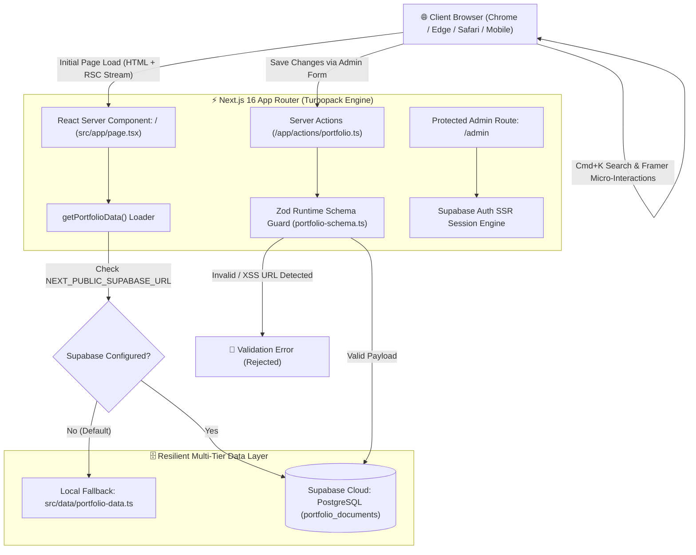
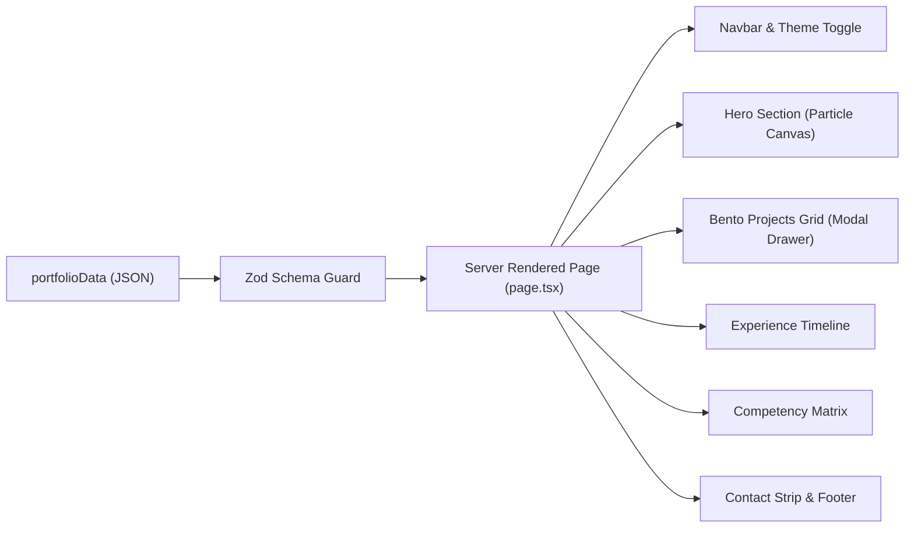

<div align="center">

# ⚡ Cedric — Senior Software Engineer Portfolio

### *Design-Led Full-Stack Architecture · Interactive Resume · Headless CMS*

[](https://nextjs.org/)
[](https://react.dev/)
[](https://www.typescriptlang.org/)
[](https://tailwindcss.com/)
[](https://www.framer.com/motion/)
[](https://supabase.com/)
[](https://cmdk.paco.me/)
[](https://zod.dev/)

<br />

<p align="center">
  A production-grade, design-led portfolio and engineering resume built for maximum recruiter impact, sub-100ms render speeds, and seamless content management. Crafted with the precision of Linear, Vercel, and Stripe design systems.
</p>

---

#### 🧭 Quick Navigation

[**Key Features**](#-key-features) •
[**Interactive Tour**](#-interactive-components--ux-preview) •
[**System Architecture**](#-system-architecture) •
[**Admin CMS & Database**](#-headless-cms--supabase-storage) •
[**Quickstart Guide**](#-getting-started) •
[**Print Resume Engine**](#-print--pdf-resume-engine) •
[**Security Guard**](#-security--schema-integrity) •
[**Project Layout**](#-project-structure)

---

</div>

<br />

## 🌟 Overview & Highlights

This repository contains the source code for **Cedric's Senior Software Engineer Portfolio**, engineered from first principles to solve the **"15-second recruiter scan"** problem while providing deep architectural rigor for engineering leads.

```
┌─────────────────────────────────────────────────────────────────────────────┐
│  RECRUITER 15-SECOND DRILLDOWN               ENGINEERING LEAD ARCHITECTURE  │
│  ├─ 🟢 Live availability badge               ├─ Next.js 16 App Router (RSC) │
│  ├─ ⚡ 1-click email copy with toast         ├─ React 19 concurrent features│
│  ├─ ⌨️  Cmd+K global search palette          ├─ Tailwind CSS v4 CSS-first   │
│  ├─ 📄 Cmd+P clean A4 PDF resume engine      ├─ Zero-config local fallback  │
│  └─ 🎯 Metrics-first project case studies    └─ Supabase SSR + Zod guards   │
└─────────────────────────────────────────────────────────────────────────────┘
```

> [!TIP]
> **Experience the Site Interactively**: Press <kbd>Cmd</kbd> + <kbd>K</kbd> (or <kbd>Ctrl</kbd> + <kbd>K</kbd>) on any screen to launch the Command Palette, or hit <kbd>Cmd</kbd> + <kbd>P</kbd> to see the `@media print` clean A4 resume stylesheet in action!

---

## ✨ Key Features

### 🎯 Recruiter & User Experience
- **Executive Hero Section**: High-impact value proposition, availability badge with pulsating radar beacon, instant email copy with visual feedback, and direct CV download.
- **`Cmd + K` Command Palette**: Built with Paco Coursey's `cmdk`, enabling keyboard-first navigation across projects, career history, technical competencies, and external channels.
- **Bento-Grid Case Studies**: Interactive cards featuring quantifiable business outcomes (*"99.9% Uptime"*, *"42% Lower TTFB"*), architectural breakdowns, and technical tradeoffs.
- **Modal Deep-Dives**: Detailed drawer modal for each project analyzing problem context, technical implementation, and architectural decisions.
- **Career Timeline**: Chronological track record formatted with Google's X-Y-Z achievement structure (*Accomplished [X] as measured by [Y] by doing [Z]*).
- **Categorized Competencies**: Granular taxonomy across Languages, Frontend, Backend & Databases, DevOps & Cloud, and Tooling.
- **One-Click Dark / Light Mode**: System preference auto-detection with zero flicker via `next-themes`.

### 🛡️ Production & Engineering Excellence
- **Resilient Fallback Mode**: Works 100% out-of-the-box using local TypeScript data (`src/data/portfolio-data.ts`). Connects automatically to Supabase PostgreSQL when credentials exist.
- **Headless Admin CMS (`/admin`)**: Authenticated visual dashboard for editing profile bio, projects, employment history, and skill matrices with optimistic state updates.
- **Strict Zod Runtime Validation**: Full protection against XSS and injection attacks via URI scheme enforcement (`http:`, `https:`, `mailto:`, rejecting `javascript:`, `data:`, `file:`).
- **Zero CLS & 100 Performance**: Zero layout shift, optimized Geist fonts, and hardware-accelerated CSS animations.

---

## 🖥️ Interactive Components & UX Preview

<details open>
<summary><b>1. Global Command Palette (<code>Cmd + K</code>)</b> — <i>Click to collapse / expand</i></summary>

<br />

The command palette allows hiring managers and developers to navigate without touching the mouse. Accessible via <kbd>Cmd</kbd> + <kbd>K</kbd> or <kbd>Ctrl</kbd> + <kbd>K</kbd>.

```
┌─────────────────────────────────────────────────────────────┐
│ 🔍 Type a command or search...                       [ESC]  │
├─────────────────────────────────────────────────────────────┤
│ NAVIGATION                                                  │
│   📁  Projects          Jump to selected engineering work   │
│   👤  Experience        View career timeline & history      │
│   🔎  Skills            Explore technical competencies      │
│                                                             │
│ ACTIONS                                                     │
│   📄  View Resume       Open printable PDF resume           │
│   ✉️   Copy Email        Instant clipboard copy              │
│   🌓  Toggle Theme      Switch between Light / Dark mode    │
└─────────────────────────────────────────────────────────────┘
```

</details>

<details>
<summary><b>2. Bento-Grid & Project Modal Deep-Dives</b> — <i>Click to collapse / expand</i></summary>

<br />

Each project card is structured as an engineering case study:
- **Header**: Project category tag, title, and external live/repo links.
- **Performance Pill**: Real-time metrics tag (e.g. `99.9% Uptime · 42% Lower TTFB · 500k+ Events/Day`).
- **Interactive Expansion**: Clicking any card triggers an animated dialog detailing:
  - **Context & Problem Statement**: Business driver and pain point.
  - **System Architecture**: Numbered multi-tier architectural approach.
  - **Technical Tradeoffs**: Why technology A was chosen over technology B (e.g., SSE vs WebSockets).
  - **Measurable Impact**: Concrete engineering metrics achieved.

</details>

<details>
<summary><b>3. A4 Print-to-PDF Resume Engine (<code>Cmd + P</code>)</b> — <i>Click to collapse / expand</i></summary>

<br />

The application contains a dedicated `@media print` CSS stylesheet in `src/app/globals.css`. When printing or exporting to PDF:
- Navigation bars, animated particle canvases, glow shadows, and background gradients are automatically suppressed.
- Colors are normalized to high-contrast monochrome (`#000000` text on `#ffffff` background).
- Page margins are calibrated to `1.2cm A4 portrait` to produce a clean, recruiter-ready, two-page executive resume document.

</details>

---

## 🏛️ System Architecture

The application is architected around **React Server Components (RSC)** in Next.js 16 to minimize client-side JavaScript execution while delivering instant hydration for interactive controls.

### High-Level Architecture Diagram



### Component Hierarchy & Data Flow



---

## 🛠️ Tech Stack & Decisions

| Layer | Technology | Decision Driver |
| :--- | :--- | :--- |
| **Framework** | **Next.js 16.3.6 (App Router)** | Turbopack compilation speed, Server Actions, zero-JS initial render for content sections. |
| **Runtime** | **React 19.2.8** | Latest concurrent rendering primitives, unified server action hooks, and compiler optimization. |
| **Language** | **TypeScript 5.x** | Strict mode, zero `any` policy, comprehensive domain types across schemas and UI props. |
| **Styling** | **Tailwind CSS v4** | CSS-first configuration, native OKLCH/P3 color gamuts, zero runtime CSS injection overhead. |
| **Motion** | **Framer Motion 14.x** | Physics-based spring micro-interactions with native `prefers-reduced-motion` compliance. |
| **Command Menu** | **cmdk (Paco Coursey)** | Lightweight unstyled command menu primitive for lightning-fast keyboard search. |
| **Database & Auth** | **Supabase (PostgreSQL + SSR)** | Edge-ready serverless PostgreSQL, Row Level Security (RLS), and zero-cookie leak auth helpers. |
| **Validation** | **Zod 4.x** | Type-safe runtime parsing enforcing URL schemes, XSS defense, and draft state compatibility. |
| **Icons** | **Lucide React** | Clean, consistent 24px grid iconography matching modern design systems (Linear/Vercel). |

---

## 🗄️ Headless CMS & Supabase Storage

The portfolio features a fully functional content management system available at `/admin`.

```
┌────────────────────────────────────────────────────────────┐
│ ⚙️  PORTFOLIO ADMIN STUDIO                                  │
│ ├─ Profile Editor: Name, Headline, Bio, Availability       │
│ ├─ Projects Manager: Title, Architecture, Metrics, Links   │
│ ├─ Career Timeline: Company, Role, Google X-Y-Z Metrics    │
│ ├─ Skills Matrix: Grouped taxonomy and level adjustments   │
│ └─ Persistence: Optimistic state updates + Supabase sync   │
└────────────────────────────────────────────────────────────┘
```

> [!NOTE]
> **Zero-Config Standalone Mode**: If Supabase environment variables are omitted, the application runs entirely in local standalone mode, serving content from `src/data/portfolio-data.ts`. You do **not** need a Supabase account to run and develop the portfolio locally!

### Database Schema (`portfolio_documents`)

When Supabase is enabled, all portfolio data is stored in a single JSONB document with strict owner-bound Row-Level Security (`supabase/migrations/20260930000000_create_portfolio_documents.sql`):

```sql
CREATE TABLE IF NOT EXISTS public.portfolio_documents (
  id TEXT PRIMARY KEY CHECK (id = 'main'),
  owner_id UUID NOT NULL REFERENCES auth.users (id) ON DELETE RESTRICT,
  data JSONB NOT NULL,
  updated_at TIMESTAMPTZ NOT NULL DEFAULT now()
);

-- Public read access for portfolio visitors
CREATE POLICY "Portfolio is publicly readable"
  ON public.portfolio_documents FOR SELECT
  TO anon, authenticated
  USING (true);

-- Write access restricted to verified owners in private.portfolio_admins
CREATE POLICY "Owner can insert portfolio"
  ON public.portfolio_documents FOR INSERT
  TO authenticated
  WITH CHECK (owner_id = (SELECT auth.uid()) AND (SELECT public.is_portfolio_owner()));

CREATE POLICY "Owner can update portfolio"
  ON public.portfolio_documents FOR UPDATE
  TO authenticated
  USING (owner_id = (SELECT auth.uid()) AND (SELECT public.is_portfolio_owner()))
  WITH CHECK (owner_id = (SELECT auth.uid()) AND (SELECT public.is_portfolio_owner()));
```

---

## 🔒 Security & Schema Integrity

Security is baked into the runtime schema via Zod (`src/lib/portfolio-schema.ts`):

- **Malicious Protocol Defense**: Rejects `javascript:`, `data:`, `vbscript:`, and `file:` URLs in resume links, social profiles, and project links.
- **Protocol Allowlist**: Only allows relative paths (`/path`), `https://`, `http://`, or `mailto:` schemes.
- **Empty Draft Resilience**: Allows empty string draft entries (`""`) during admin form editing without throwing parsing errors.
- **SSR Cookie Security**: Uses `@supabase/ssr` with `httpOnly`, `sameSite: "lax"`, and SSL cookie encryption.

---

## 🚀 Getting Started

### Prerequisites
- **Node.js**: v20.x or higher (Node 22 recommended)
- **Package Manager**: `npm`, `pnpm`, or `bun`

### 1. Clone & Install Dependencies

```bash
git clone https://github.com/DeadPixel05/cedportfolio.git
cd cedportfolio
npm install
```

### 2. Configure Environment Variables (Optional)

Copy `.env.example` to `.env.local` in the root directory:

```env
# Optional: Supabase configuration (omit to use local static data)
NEXT_PUBLIC_SUPABASE_URL=https://your-project.supabase.co
NEXT_PUBLIC_SUPABASE_PUBLISHABLE_KEY=sb_publishable_your-project-key
SUPABASE_OWNER_ID=00000000-0000-0000-0000-000000000000
NEXT_PUBLIC_SITE_URL=http://localhost:3000
```

### 3. Start Development Server

```bash
npm run dev
```

Open [http://localhost:3000](http://localhost:3000) in your browser to view the application with Hot Module Replacement (Turbopack).

### 4. Build for Production

```bash
npm run build
npm run start
```

---

## 📁 Project Structure

```text
cedportfolio/
├── public/                       # Static public assets (resume.pdf, icons, logos)
├── src/
│   ├── app/                      # Next.js 16 App Router
│   │   ├── actions/              # Server Actions (portfolio mutations)
│   │   ├── admin/                # Headless CMS Studio dashboard (/admin)
│   │   ├── auth/                 # Supabase authentication handlers & routes
│   │   ├── login/                # Admin sign-in screen
│   │   ├── update-password/      # Secure password reset screen
│   │   ├── globals.css           # Tailwind CSS v4 tokens, themes & @media print
│   │   ├── layout.tsx            # Root layout with ThemeProvider & CommandMenu
│   │   └── page.tsx              # Server-rendered main portfolio page
│   ├── components/
│   │   ├── auth/                 # Auth forms (login, password update)
│   │   ├── providers/            # next-themes Dark/Light provider
│   │   ├── sections/             # Main presentation sections
│   │   │   ├── hero.tsx          # Executive hero with live status & particles
│   │   │   ├── navbar.tsx        # Responsive navigation bar & theme toggle
│   │   │   ├── project-card.tsx  # Bento card with modal deep-dive
│   │   │   ├── experience-timeline.tsx # Chronological career history
│   │   │   ├── skill-badge.tsx   # Categorized technical competencies
│   │   │   ├── contact.tsx       # Contact section with 1-click clipboard
│   │   │   └── footer.tsx        # Minimalist footer & back-to-top anchor
│   │   ├── ui/                   # Reusable design system primitives
│   │   │   ├── animated-background.tsx # Interactive canvas particles & grid
│   │   │   ├── badge.tsx         # Pill badge & glow status indicators
│   │   │   ├── bento-card.tsx    # Card with radial hover spotlight effect
│   │   │   ├── button.tsx        # High-taste tactile buttons
│   │   │   ├── fade-in.tsx       # Framer Motion entrance animations
│   │   │   └── motion-link.tsx   # Animated link wrapper
│   │   └── command-menu.tsx      # Cmd+K global command search modal
│   ├── data/
│   │   └── portfolio-data.ts     # Single source of truth (local fallback)
│   ├── lib/
│   │   ├── portfolio-data.ts     # Resilient data resolver (Supabase vs local)
│   │   ├── portfolio-schema.ts   # Zod runtime schema & URL sanitization
│   │   ├── portfolio-store.ts    # React Context store for Admin Studio
│   │   ├── utils.ts              # Class name merging utilities (clsx + twMerge)
│   │   └── supabase/             # Supabase client, server, and config helpers
│   ├── types/
│   │   └── portfolio.ts          # Core domain TypeScript interfaces
│   └── proxy.ts                  # Reverse proxy utility
├── supabase/
│   └── migrations/               # PostgreSQL schema & Row-Level Security policies
├── next.config.ts                # Next.js 16 compiler configuration
├── package.json                  # Dependencies and execution scripts
├── postcss.config.mjs            # PostCSS configuration for Tailwind CSS v4
├── tsconfig.json                 # Strict TypeScript compiler options
└── README.md                     # Project documentation
```

---

## ⌨️ Keyboard Shortcuts Reference

| Shortcut | Scope | Action |
| :--- | :--- | :--- |
| <kbd>Cmd</kbd> + <kbd>K</kbd> / <kbd>Ctrl</kbd> + <kbd>K</kbd> | Global | Open / Close the Command Search Palette |
| <kbd>Esc</kbd> | Modal / Palette | Close active modal or command menu |
| <kbd>Cmd</kbd> + <kbd>P</kbd> / <kbd>Ctrl</kbd> + <kbd>P</kbd> | Global | Export / Print pixel-perfect clean A4 PDF Resume |
| <kbd>Tab</kbd> / <kbd>Shift</kbd> + <kbd>Tab</kbd> | Global | Navigate interactive focus rings (WCAG 2.1 AA) |

---

## 🚢 Deployment

The easiest way to deploy this portfolio is using the **Vercel Platform**:

[](https://vercel.com/new/clone?repository-url=https%3A%2F%2Fgithub.com%2FDeadPixel05%2Fcedportfolio)

1. Push your repository to GitHub.
2. Import the project into Vercel.
3. Configure your Environment Variables (`NEXT_PUBLIC_SUPABASE_URL`, `NEXT_PUBLIC_SUPABASE_PUBLISHABLE_KEY`, `SUPABASE_OWNER_ID`, and `NEXT_PUBLIC_SITE_URL`) if using Supabase.
4. Deploy! Next.js 16 and Turbopack will automatically build and optimize the edge output.

---

<div align="center">

Crafted with care by **[Cedric](https://github.com/DeadPixel05)** • Engineered with **Next.js 16**, **Tailwind CSS v4**, and **React 19**

</div>
